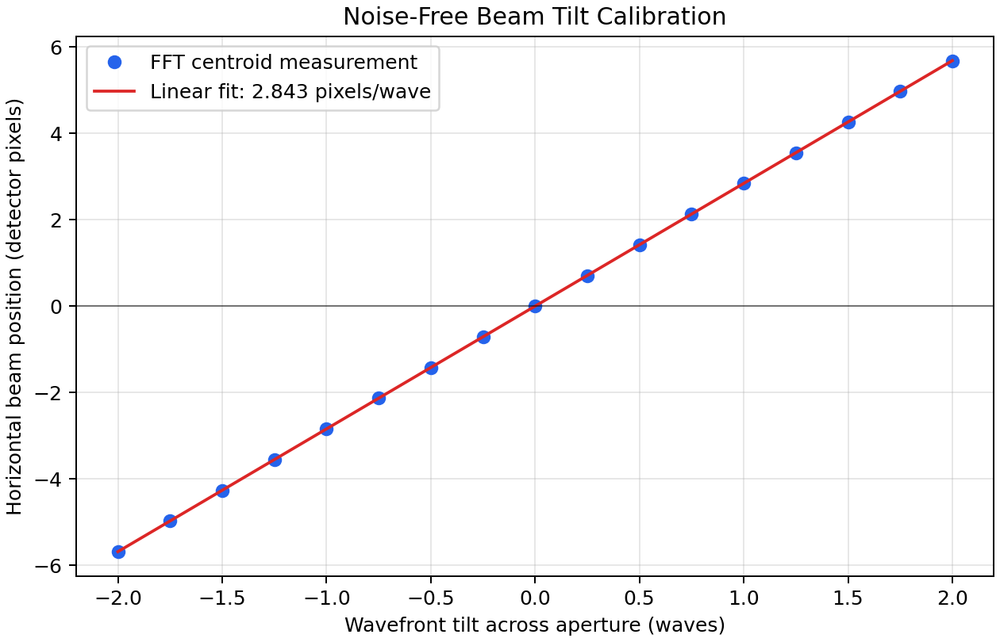
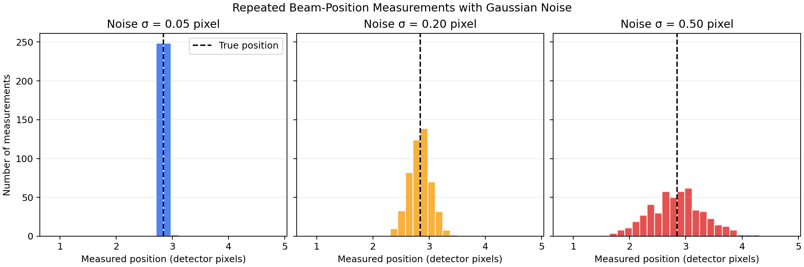
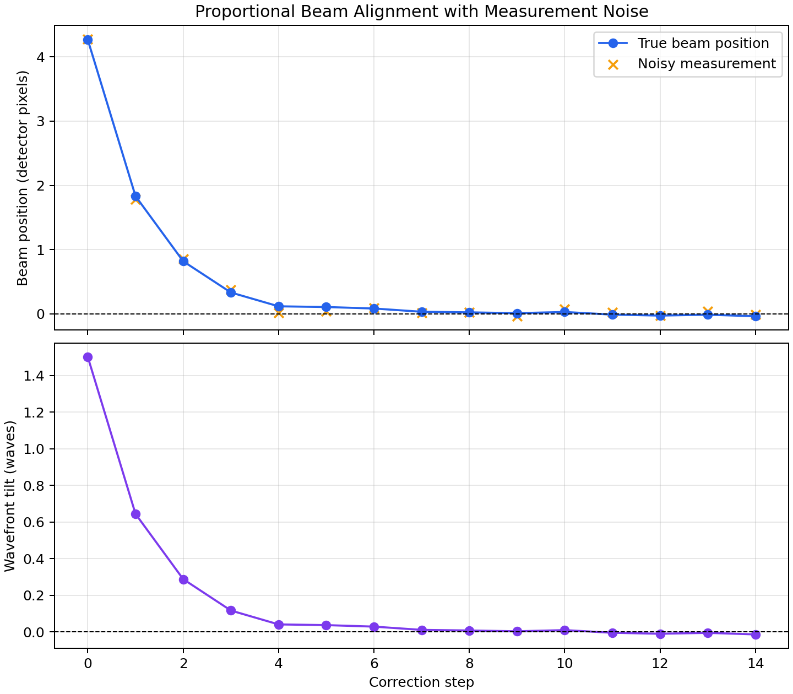
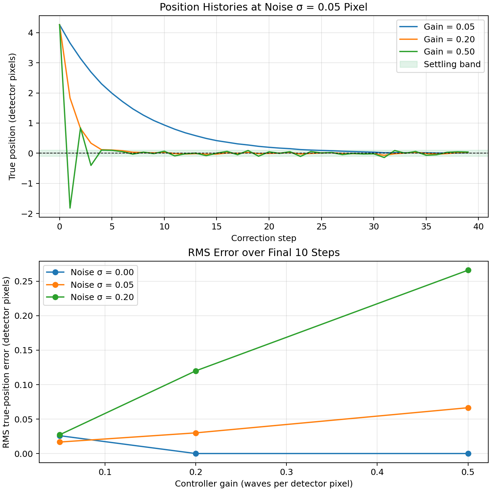
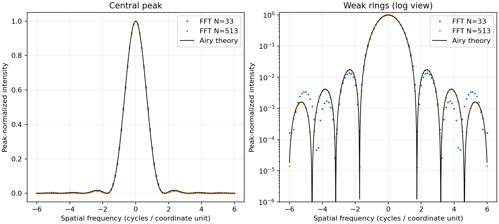
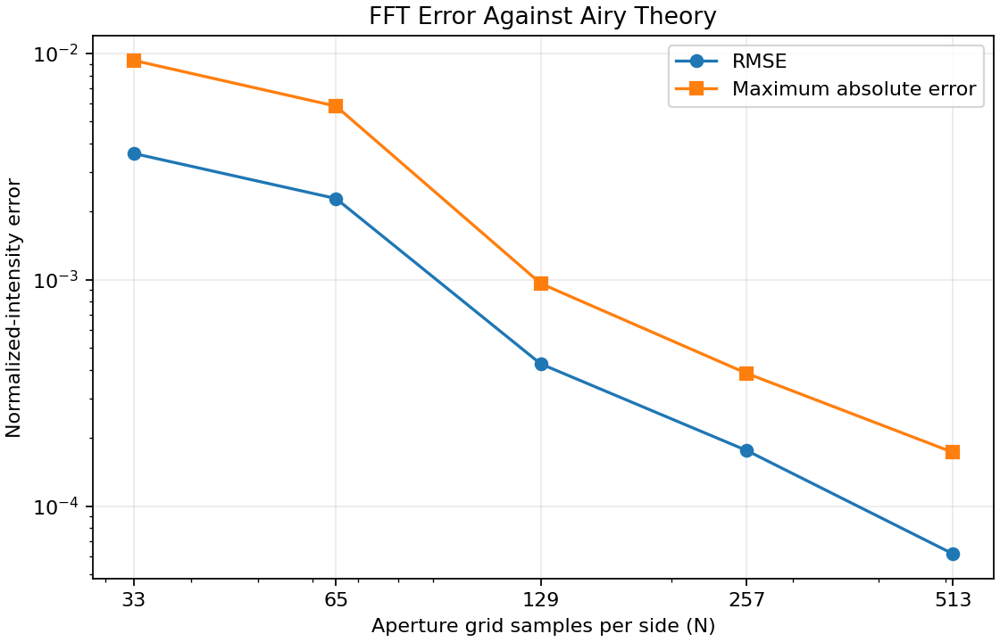

# Introductory Fourier-Optics Study

This folder is a small computational-optics study built as part of my Engineering Physics learning portfolio. The goal was to understand how an aperture and simple wavefront errors affect a far-field diffraction pattern, then check that the numerical result is stable when the grid is refined.

It is a learning project, not a model of NIF or a complete laser system.

## Main Question

How do aperture shape, defocus, and wavefront tilt change the far-field intensity pattern of coherent light?

The numerical model follows this sequence:

```text
aperture field -> phase error -> 2D FFT -> |amplitude|^2 -> intensity
```

For a circular aperture of radius `a`, the field is `1` inside the aperture and `0` outside it. Two simple phase models are used:

```text
defocus phase = 2 * pi * defocus_waves * (radius / a)^2
tilt phase    = 2 * pi * tilt_waves * x / (2 * a)
```

The calculations use normalized coordinates, so the plots show spatial-frequency samples rather than physical detector distances or angles.

## Study Sequence

| File | Question | Main output |
| --- | --- | --- |
| `fourier_optics.py` | What reusable calculations are needed? | Coordinate grids, aperture fields, phase errors, and FFT intensity |
| `diffraction_study.py` | What does ideal circular-aperture diffraction look like? | Two-dimensional pattern and center cross-section |
| `defocus_study.py` | How does one defocus value change the pattern? | Ideal and defocused patterns on the same intensity scale |
| `defocus_sweep.py` | How quickly does peak intensity fall as defocus grows? | Relative peak intensity from `0.0` to `1.0` wave |
| `tilt_study.py` | Does every phase error blur the pattern? | Beam-pointing shift caused by a linear phase ramp |
| `grid_convergence_study.py` | Is the reported defocus result dependent on grid size? | Peak intensity across five numerical resolutions |
| `airy_validation.py` | Does the ideal FFT result agree with independent theory? | Airy comparison and absolute error versus grid size |
| `beam_alignment.py` | Can beam position be measured before adding feedback? | Noise-free tilt-to-centroid calibration |
| `beam_noise_study.py` | How does measurement noise change repeated beam readings? | Centroid distributions at three noise levels |
| `beam_feedback_control.py` | Can simple feedback reduce a noisy beam-position error? | Position and tilt histories during one alignment run |
| `beam_gain_noise_study.py` | How do gain and measurement noise affect control? | RMS error, settling step, and representative histories |

## Key Results

| Experiment | Result |
| --- | --- |
| Ideal circular aperture | Bright central diffraction feature with weaker surrounding rings |
| `0.5` waves of defocus | Peak intensity falls to about `0.405` of the ideal peak |
| `1.0` wave of defocus | Peak intensity falls to about `0.049` of the ideal peak |
| `2.0` waves of tilt | Peak moves by `6` simulation pixels while retaining about `0.979` relative peak intensity |
| Beam-position calibration | Centroid changes by about `2.843` detector pixels per wave of tilt from `-2.0` to `2.0` waves |
| Repeated noisy measurements | Larger input noise produces a wider distribution while the average remains close to the true position |
| Proportional beam alignment | One example reduces the absolute true position from `4.2640` to `0.0379` detector pixels in 15 recorded steps |
| Gain and noise comparison | Larger gain responds faster without noise but produces more residual motion when measurements are noisy |
| Grid refinement | The `0.5`-wave result changes by only `0.000084` from `257 × 257` to `513 × 513` |

These results show that defocus and tilt have different signatures. Defocus spreads light and lowers the peak, while tilt mainly shifts the location of the pattern.

## Run the Studies

Run the scripts from the repository root so the figures are saved in `assets/`:

```bash
python3 05_Optics/diffraction_study.py
python3 05_Optics/defocus_study.py
python3 05_Optics/defocus_sweep.py
python3 05_Optics/tilt_study.py
python3 05_Optics/grid_convergence_study.py
python3 05_Optics/airy_validation.py
python3 05_Optics/beam_alignment.py
python3 05_Optics/beam_noise_study.py
python3 05_Optics/beam_feedback_control.py
python3 05_Optics/beam_gain_noise_study.py
```

Run the automated tests with:

```bash
python3 -m unittest discover -s tests -v
```

## What the Tests Check

The tests verify several physical and numerical expectations:

- the aperture and ideal diffraction pattern are centered and symmetric;
- a larger aperture produces a narrower central diffraction feature;
- zero defocus and zero tilt recover the original aperture field;
- phase errors preserve the aperture amplitude;
- defocus lowers the far-field peak;
- positive and negative tilt move the peak in opposite directions;
- a finite detector window measures centered and tilted beam centroids;
- the noise-free beam position changes in the expected direction as tilt grows;
- a moderate proportional gain reduces a noise-free initial beam offset;
- a fixed random seed reproduces the same noisy control history;
- RMS error uses only the stated steady-state window;
- settling requires the beam to remain inside the stated tolerance;
- finer grids produce a more stable defocus result;
- each plotting function can write to a requested output directory.

## Active Alignment: Day One Baseline

The first active-alignment milestone adds a measurement before adding a
controller. For each horizontal wavefront tilt, the script calculates the FFT
intensity and measures its intensity-weighted horizontal centroid inside a
centered `61 × 61` detector window:

```text
x_centroid = sum(x_pixel * intensity) / sum(intensity)
```

Position is reported in detector pixels because this normalized model does not
define a physical detector distance. Seventeen tilt values from `-2.0` to
`2.0` waves produce a nearly linear calibration with a fitted slope of about
`2.8427 detector pixels per wave`. The zero-tilt position is numerically zero.



This is intentionally only the sensor baseline. Measurement noise and the
proportional feedback loop will be added in later milestones, after confirming
that the noise-free measurement behaves predictably.

## Active Alignment: Day Two Measurement Noise

Day Two keeps the true optical pattern unchanged and adds zero-mean Gaussian
uncertainty to the measured centroid:

```text
x_measured = x_true + noise
noise ~ Normal(0, sigma^2)
```

This is a simple detector-position model. It represents uncertainty after the
centroid has been calculated; it is not a model of photon noise or individual
camera pixels. A fixed random seed makes the experiment repeatable.

For a `1.0`-wave tilt, the noise-free position is about `2.8428` detector
pixels. Each case below uses 500 repeated measurements:

| Input noise σ (pixels) | Measured mean (pixels) | Measured sample σ (pixels) |
| ---: | ---: | ---: |
| 0.05 | 2.8422 | 0.0480 |
| 0.20 | 2.8402 | 0.1920 |
| 0.50 | 2.8363 | 0.4800 |

The measured spreads are close to their requested noise levels. Their small
differences are expected from a finite random sample. More noise increases
measurement uncertainty, but it does not create a large systematic shift in
the average reading in this zero-mean model.



Day Three uses these noisy readings as the input to a simple proportional
alignment controller.

## Active Alignment: Day Three Proportional Feedback

Day Three closes the loop. At each recorded step, the script calculates the
true centroid with the existing FFT model, adds one noisy sensor reading, and
uses that reading to update the horizontal wavefront tilt:

```text
tilt_next = tilt_current - gain * measured_position
```

The gain therefore has units of `waves per detector pixel`. The example uses
an initial tilt of `1.50 waves`, a gain of `0.20 waves per detector pixel`, a
measurement-noise standard deviation of `0.05 detector pixel`, and a fixed
random seed. It records 15 states, including the initial condition.

In this one run, the true beam position changes from `4.2640` detector pixels
to `-0.0379` detector pixels. The small motion near zero comes from responding
to noisy measurements; this is not evidence that the same gain is best for
every noise level.



This milestone demonstrates the feedback idea with one moderate gain. Day Four
below compares gains and noise levels and introduces RMS position error and
settling time as a separate experiment.

## Active Alignment: Day Four Gain and Noise Study

Day Four compares three controller gains and three measurement-noise levels.
Every case starts at `1.50 waves` of tilt, records 40 states, and uses the same
random seed. Two simple metrics make the comparison quantitative:

```text
steady-state RMS = sqrt(mean(true_position^2 over the final 10 states))
settling step = first step after which |true_position| stays <= 0.10 pixel
```

If the position does not remain inside that band, the table reports
`not settled`.

| Gain (waves/pixel) | Noise σ (pixels) | RMS error (pixels) | Settling step |
| ---: | ---: | ---: | ---: |
| 0.05 | 0.00 | 0.0259 | 25 |
| 0.05 | 0.05 | 0.0167 | 25 |
| 0.05 | 0.20 | 0.0272 | 24 |
| 0.20 | 0.00 | 0.0000 | 5 |
| 0.20 | 0.05 | 0.0300 | 6 |
| 0.20 | 0.20 | 0.1200 | not settled |
| 0.50 | 0.00 | 0.0000 | 5 |
| 0.50 | 0.05 | 0.0665 | 32 |
| 0.50 | 0.20 | 0.2661 | not settled |



The `0.05` gain is slow but reacts less strongly to noisy readings. The `0.20`
gain reaches the settling band much sooner at low noise. The `0.50` gain
alternates around zero and has the largest RMS error when noise is present.
This illustrates a basic control tradeoff: a stronger correction can improve
speed while also amplifying measurement noise.

These values come from one fixed, repeatable noise sequence rather than an
average of many random trials, so every row should not be interpreted as a
universal monotonic trend. Day Five will check the final assumptions,
reproducibility, edge cases, and explanation without making the controller
more complicated.

## Validation Against the Airy Pattern

The original convergence study checks stability of a defocused peak. This
additional experiment compares the ideal circular aperture with an independent
analytical solution, under uniform coherent illumination and zero phase error:

```text
u = 2*pi*a*f
I(f)/I(0) = (2*J1(u)/u)**2
I(0)/I(0) = 1
```

Here `a` is aperture radius and `f` is spatial frequency in cycles per coordinate
unit. `J1` is the first-order Bessel function, evaluated using
[SciPy's j1](https://docs.scipy.org/doc/scipy/reference/generated/scipy.special.j1.html).
The circular-aperture result is described in Goodman's
[Introduction to Fourier Optics, section 4.3.2](https://neurophysics.ucsd.edu/courses/physics_4L/Introduction%20to%20Fourier%20Optics.pdf).
The first dark ring occurs at `u ≈ 3.831706`.

Install the updated requirements in an active virtual environment before running:

```bash
python -m pip install -r requirements.txt
python 05_Optics/airy_validation.py
python -m unittest discover -s tests -p 'test_airy_validation.py'
```

The experiment fixes the coordinate span at `L=2.0` and radius at `a=0.35`.
Because the existing grid includes both endpoints, its spacing is `L/(N-1)`.
Each aperture is zero-padded to `M=4*(N-1)` samples per side, giving the same
frequency spacing `1/(M*spacing)=0.125` on every grid. Zero-padding samples the
transform more densely; only increasing `N` refines the aperture boundary.

Errors use the central horizontal cross-section at the same 97 frequency
points in `[-6, 6]`. Both curves have unit central intensity. We calculate
`RMSE = sqrt(mean((FFT - theory)**2))` and `max(abs(FFT - theory))`.
These are absolute errors in normalized intensity, not pointwise percentage
errors, which would be undefined at theoretical dark rings.

| Aperture grid N | RMSE | Maximum absolute error |
| --- | --- | --- |
| 33 | 3.619318e-3 | 9.327582e-3 |
| 65 | 2.286820e-3 | 5.853074e-3 |
| 129 | 4.253615e-4 | 9.635404e-4 |
| 257 | 1.763124e-4 | 3.864315e-4 |
| 513 | 6.154981e-5 | 1.728819e-4 |




For these grids, RMSE decreases by about 59 times from the coarsest to finest
grid. The staircase approximation to the circular boundary contributes to the
remaining error. Other grid choices need not decrease monotonically, and this
experiment does not establish a particular convergence order. The tests check
the theoretical center and first zero, shared frequency coordinates, and
coarse-to-fine agreement without requiring every refinement to improve.

This validates the normalized ideal center slice over the chosen frequency
range. It does not independently validate absolute optical power, the entire
2D field, or the defocus and tilt models.

## Limitations

- The model uses scalar Fraunhofer diffraction.
- Coordinates and spatial-frequency axes are normalized.
- The source is treated as ideal, coherent, and monochromatic.
- Defocus and tilt are simplified phase functions rather than measured optical surfaces.
- The model does not include lenses, propagation distance, polarization, photon-level camera noise, or actuator limits.
- The controller is one-dimensional proportional feedback, not a model of a complete optical-alignment system.

The most important lesson from this project was not only how to generate a diffraction plot, but how to compare cases fairly, vary one parameter at a time, test expected behavior, and check numerical convergence.
